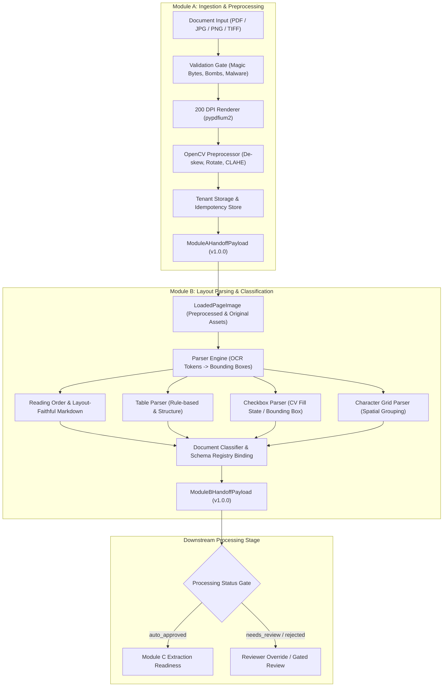

# Document Extraction Engine

## Overview

The **Document Extraction Engine** is an on-premise, schema-driven system designed to transform scanned BFSI (banking, financial services, insurance) and healthcare documents into validated, evidence-grounded structured data.

The system is architected as a modular, decoupled processing pipeline following the authoritative **PRD v1.1** specification:
1. **Module A — Document Ingestion & Preprocessing**: Safe reception, multi-format validation, 200 DPI rendering, image de-skewing, normalization, and secure tenant storage.
2. **Module B — Layout Parsing & Document Classification**: Visual layout structure parsing (blocks, reading order, Markdown formatting), structural element extraction (tables, checkboxes, character grids), deterministic document classification, and schema binding.
3. **Module C — Extraction & Grounding**: *(In active development / runtime preparation — not documented as a completed project feature)*.

---

## Architecture & Workflow

The verified processing pipeline coordinates data transfer across strict boundary envelopes and coordinate spaces:



---

## Implemented Module Capabilities

### 1. Module A: Document Ingestion & Preprocessing

Module A acts as Stage 1 of the engine, accepting raw incoming document files and producing clean, standardized, 200-DPI page artifacts with invertible transformation histories:

- **Multi-Format Ingestion (`FR-ING-001`)**: Accepts PDF, JPG, PNG, and TIFF formats via structured ingestion interfaces.
- **Strict Input Validation & Security (`FR-ING-002`, `GR-001`)**:
  - Binary magic-byte sniffing (`%PDF-`, `\xFF\xD8\xFF`, `\x89PNG\r\n\x1a\n`, `II*\x00` / `MM\x00*`) to reject spoofed extensions (`UNSUPPORTED_FILE`).
  - Page count boundaries and dimension limits protecting against decompression bombs (`GR-001`).
- **Pluggable Malware Boundary (`FR-ING-003`, `SEC-009`)**:
  - `MalwareScanner` boundary interface with fail-closed behavior (`SCANNER_UNAVAILABLE`).
  - Rejection with audit status `rejected_malware` on signature detection (e.g. EICAR).
- **Standardized 200 DPI PDF Rendering (`FR-ING-004`, `SCH-013`)**:
  - `pypdfium2` rendering engine scaled strictly at $200 / 72.0 \approx 2.7778$ to produce uniform 200-DPI images.
  - Multi-page splitting with 1-based page ordering, dimension tracking, and parent `document_id` linkage.
- **OpenCV Image Cleaning & Preprocessing (`FR-ING-005`)**:
  - De-skewing via Probabilistic Hough Line Transform (`HoughLinesP`).
  - Orientation analysis using text projection profile variance.
  - Contrast normalization via Contrast Limited Adaptive Histogram Equalization (CLAHE).
  - Transformation metadata persistence (angle, residual skew, scale, padding) enabling full inversion.
- **Coordinate Transformation Inversion (`SCH-013`)**:
  - `CoordinateTransform.map_bbox_preprocessed_to_original()` accurately projects downstream 200-DPI preprocessed bounding boxes back to original un-skewed page coordinates.
- **Tenant-Isolated Storage & Replay Protection (`FR-ING-006`, `SEC-005`, `API-013`)**:
  - Storage segregated strictly by `{storage_base_dir}/{tenant_id}/{document_id}/` with traversal guards.
  - 24-hour replay protection using `Idempotency-Key` and streaming SHA-256 content hashing with per-key concurrency locking (`NFR-006`).
- **Structured Handoff Envelope (`ARC-003`, `SCH-011`)**:
  - Produces immutable, serializable `ModuleAHandoffPayload` (v1.0.0) recording document metadata, page counts, hashes, and relative storage URIs.

---

### 2. Module B: Visual Layout Parsing & Document Classification

Module B acts as Stage 2 of the engine, consuming `ModuleAHandoffPayload` and transforming raw pixels into structured visual layout blocks, specialized form components, and validated document classifications:

- **Pluggable Parser Engine Architecture (`ARC-002`, `FR-PRS-001`)**:
  - `ParserEngine` interface with `LocalOCRParserAdapter` accepting raw OCR tokens.
  - Preserves optical confidence scores ($[0.0, 1.0]$) alongside bounding boxes and text content (`FR-PRS-005`).
- **Visual Layout & Reading-Order Formatting (`FR-PRS-001`)**:
  - Token sorting and block aggregation preserving logical reading order (top-to-bottom, left-to-right).
  - Emits layout-faithful page Markdown representations for LLM consumption.
- **Structured Table Extraction (`FR-PRS-002`)**:
  - Detection of tabular regions, header rows, data cells, row spans, and column spans.
  - Emits normalized cell coordinates and confidence metrics.
- **Checkbox Detection & Interpretation (`FR-PRS-003`)**:
  - Form field checkbox parsing calculating fill states (`checked`, `unchecked`, `indeterminate`) using contour pixel-density thresholds.
  - Links visual bounding boxes with adjacent label tokens.
- **Character Grid Extraction (`FR-PRS-004`)**:
  - Detects segmented character boxes common in Indian identity documents, PAN applications, and bank account forms.
  - Spatial grouping of adjacent individual letter cells into unified field tokens.
- **Document Classification & Schema Binding (`FR-CLS-001` - `FR-CLS-004`)**:
  - Deterministic classification engine evaluating keyword distributions, visual layouts, and form signatures across standard banking documents (e.g. DOC-01 Bank Account Opening Form, DOC-02 KYC, DOC-03 Cheque).
  - Schema registry binding matching classified documents to validated target extraction schemas.
  - Threshold-gated decision rules: classifications above threshold are marked `auto_approved`; low confidence or ambiguous matches route to `needs_review`.
- **Pipeline Orchestration & Lifecycle Status Gates (`SCH-012`)**:
  - Unified pipeline coordinator (`ModuleBPipeline`) executing:
    $$\text{Payload Handoff} \longrightarrow \text{Image Loading} \longrightarrow \text{Layout Parsing} \longrightarrow \text{Classification} \longrightarrow \text{Status Gating}$$
  - Enforces processing state transitions (`processing`, `auto_approved`, `needs_review`, `rejected`, `failed`).
  - Supports explicit reviewer overrides to amend classification or schema assignment during manual validation.
- **Structured Module B Handoff Payload (`SCH-011`)**:
  - Emits versioned `ModuleBHandoffPayload` containing complete page layout structures, tables, checkboxes, character grids, classification metadata, and markdown text.

---

## Security & Deployment Boundaries

1. **Egress Isolation (`ARC-001`, `SEC-011`)**:
   - Application configuration (`Settings`) enforces `allow_external_egress=False` and fails closed on startup if external network egress is enabled.
   - *Deployment Requirement*: Container/infrastructure firewalls must enforce total egress blocking.
2. **Tenant Isolation & Path Traversal Guards (`SEC-005`, `SEC-006`)**:
   - Filesystem operations strictly contained within `{storage_base_dir}/{tenant_id}/{document_id}/`.
   - Any path traversal sequence (`..`, `/`, `\`) is rejected immediately.
3. **Malware Defense (`SEC-009`)**:
   - Clean boundary separation ensures un-scanned or infected payloads cannot advance to rendering or layout parsing.
4. **Idempotency & Concurrency Safety (`API-013`, `NFR-006`)**:
   - Replay protection with streaming SHA-256 hashing and per-key threading locks prevents duplicate creation under identical concurrent requests.

---

### 3. Module C: Field Extraction, Validation & Canonical Envelope

Module C acts as Stage 3 of the engine, consuming `ModuleBOutputPayload` and transforming layout blocks, tables, character grids, and checkboxes into validated, evidence-grounded canonical JSON:

- **Schema-Constrained Extraction (`FR-EXT-001`, `FR-EXT-002`)**:
  - Implements `SchemaGuidedExtractor` supporting local LLM grammar decoding (Instructor + LiteLLM) with deterministic heuristic fallback.
  - Supports launch document types: DOC-01 CASA Account Opening, DOC-02 Insurance Application, and DOC-03 Hospital Discharge Summary.
- **Null-if-Absent Logic (`FR-EXT-003`, `GR-003`)**:
  - Strictly returns `value: null` with `null_reason: "absent"` or `"illegible"` for absent or unreadable fields; zero inference/hallucination.
- **Pixel-Space Evidence Grounding (`FR-EXT-004`, `GR-002`, `SCH-013`)**:
  - Links every non-null extracted value to 1-based page, 200-DPI pixel bounding box `(x0, y0, x1, y1)`, and raw source snippet.
  - Ungrounded values are forced to `value: null`, `null_reason: "absent"`, `review_required: true`, and flagged with `EVIDENCE_MISSING`.
- **Repeating Groups & Arrays (`FR-EXT-005`)**:
  - Extracts repeating groups maintaining sequential page order (nominees in DOC-02, medications in DOC-03).
- **Checkbox Mapping (`FR-EXT-007`)**:
  - Normalizes visual checkbox marks `[x]` to `true`, `[ ]` to `false`, and flags uncertain marks.
- **Field Normalization (`FR-VAL-001`)**:
  - Dates normalized to ISO 8601 (`YYYY-MM-DD`).
  - Phone numbers normalized to E.164 (`+91...`).
  - Currency/amounts parsed to decimal floats with ISO 4217 currency codes.
- **Format Validators (`FR-VAL-002`)**:
  - Indian PAN format validation (`^[A-Z]{5}[0-9]{4}[A-Z]$`).
  - Indian Aadhaar 12-digit format and Verhoeff checksum algorithm validation.
  - Indian IFSC code format validation (`^[A-Z]{4}0[A-Z0-9]{6}$`).
- **Business Logic & Cross-Field Rules (`FR-VAL-003`, `FR-VAL-004`)**:
  - Arithmetic reconciliation of itemized amounts vs declared total (`ARITHMETIC_MISMATCH`).
  - Chronology validation ensuring discharge date $\ge$ admission date (`CHRONOLOGY_MISMATCH`).
- **Calibrated Confidence & Status Gating (`FR-CNF-001` - `FR-CNF-003`, `GR-027`)**:
  - Calibrated field confidence math combining optical OCR confidence, model score, and validation status.
  - Threshold gating: scores $< 0.75$ or validation failures trigger `review_required: true`.
  - Document status gating: documents auto-approve only when all fields pass with no review flags, otherwise routing to `needs_review`.
- **Canonical JSON Output Envelope (`SCH-011` - `SCH-013`)**:
  - Versioned `CanonicalExtractionEnvelope` adhering strictly to PRD §6.3.

---

## Project Setup & Local Development

### 1. Prerequisites
- **Python**: Version 3.10 or higher.
- **Operating System**: Linux, macOS, or Windows (tested on Windows 11 with Python 3.10.0).

### 2. Environment Installation

```bash
# Create and activate virtual environment
python -m venv .venv

# On Linux/macOS:
source .venv/bin/activate

# On Windows (PowerShell):
.venv\Scripts\Activate.ps1

# Install package and dependencies in editable mode
pip install -e .
```

### 3. Configuration

```bash
# Copy example configuration
cp .env.example .env     # Linux/macOS
Copy-Item .env.example .env  # Windows PowerShell
```

---

## Testing & Verification Status

### Automated Test Suite
The repository includes comprehensive unit, regression, and end-to-end handoff test coverage across Module A, Module B, and Module C:
- **Module A Coverage**: File validation, decompression bomb protection, malware scanner gating, 200 DPI PDF rendering, OpenCV de-skew / contrast CLAHE, idempotency storage, and handoff contracts.
- **Module B Coverage**: Parser engine adapter, coordinate inversion, reading-order Markdown generation, table extraction, checkbox fill detection, character grid grouping, document classification, schema binding, and Module B pipeline orchestration.
- **Module C Coverage**: Schema-guided field extraction, visual evidence grounding (bounding boxes and text snippets), Indian format validation (PAN, Aadhaar Verhoeff checksum, IFSC), currency/date/phone normalization, arithmetic/chronology cross-field rules, calibrated confidence calculations, and PRD §6.3 canonical JSON output envelope.

**Reported Test Result**:
- Full automated test suite passes with **183+ tests passing** (0 failures).

To run the automated test suite locally:
```bash
pytest -v -k "not live_model"
```

---

## Current Scope Boundaries & Known Limitations

This project is under active development. The current codebase implements **Module A**, **Module B**, and **Module C**. Known open gaps and architecture prerequisites include:

- **Module B OCR Runtime Connection**: While Module B provides the pluggable `ParserEngine` interface and `LocalOCRParserAdapter`, the current pipeline tests operate on deterministic mock extractors; direct cross-process worker integration with isolated local OCR engines (e.g. PaddleOCR) remains to be connected.
- **Local Model Serving Cluster**: Module C supports pluggable LLM extraction (LiteLLM/Instructor) and deterministic extraction heuristics; production deployment on-premise requires containerized vLLM/Ollama services with GPU acceleration per PRD ARC-004/ARC-005.
- **Durable Message Broker**: Inter-module queues currently provide an in-memory adapter (`LocalMemoryQueueAdapter`); production deployment requires connecting a persistent broker (e.g. RabbitMQ or Redis Streams).
- **Distributed Idempotency & Locking**: Current concurrency locking is process-local; multi-replica horizontal clustering requires a shared distributed cache (e.g. Redis).
- **Antivirus Daemon**: Production environments require configuring a live ClamAV daemon socket rather than the development mock scanner.
- **Encryption at Rest**: Customer-held AES-256 volume encryption must be managed at the storage/cloud provider infrastructure layer per `SEC-005`.
